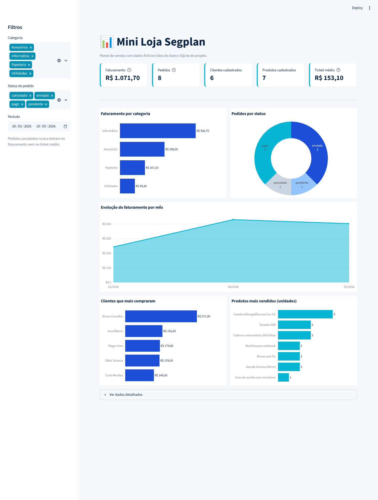

# DataShop | Inteligência de Vendas

Projeto acadêmico do **Desafio Final da Trilha de Engenharia de Dados JR**.
Uma loja virtual simples, com banco **SQLite**, consultas em **SQL** e relatórios em **Python**.

> Todos os dados são **fictícios**, criados apenas para estudo.

## Estrutura de pastas

```
.
├── data/
│   ├── schema.sql     # criação das tabelas
│   ├── seed.sql       # dados fictícios
│   └── views.sql      # view vw_total_por_pedido
├── dashboard/
│   ├── app.py         # dashboard Streamlit (tela, filtros e gráficos)
│   └── dados.py       # lê o SQLite e calcula os indicadores (pandas)
├── docs/
│   └── dashboard.png  # print do dashboard
├── src/
│   ├── database.py    # conecta e monta o banco
│   ├── queries.py     # consultas SQL (uma função por consulta)
│   └── main.py        # menu interativo no terminal
├── tests/
│   └── test_dashboard.py  # confere os cálculos do dashboard com o SQL
├── .streamlit/config.toml # cores do dashboard
├── requirements.txt
└── README.md
```

## Modelo de dados

```
clientes 1 ──< N pedidos 1 ──< N itens_pedido >── 1 produtos
```

| Tabela         | O que guarda                          | Chave estrangeira                     |
|----------------|---------------------------------------|---------------------------------------|
| `clientes`     | quem compra                           | —                                     |
| `produtos`     | o que a loja vende                    | —                                     |
| `pedidos`      | cada compra feita por um cliente      | `cliente_id` → `clientes.id`          |
| `itens_pedido` | os produtos dentro de cada pedido     | `pedido_id` → `pedidos.id`, `produto_id` → `produtos.id` |

## Como rodar

Requisitos: [Python](https://www.python.org/downloads/) 3.10 ou superior e Git.
O menu do terminal não precisa de bibliotecas extras. Só o dashboard (opcional) precisa.

**1. Baixe o projeto e entre na pasta:**

```bash
git clone https://github.com/apristhais-png/desafio-final-engenharia-dados-jr.git
cd desafio-final-engenharia-dados-jr
```

**2. Crie o banco:**

```bash
python src/database.py
```

> **Windows:** se o comando `python` não for reconhecido, use `py` no lugar
> (ex.: `py src\database.py` e `py src\main.py`). No macOS/Linux pode ser `python3`.

O comando cria o arquivo `data/loja.db` com as tabelas, os dados de exemplo e a view.

**3. Abra o menu interativo:**

```bash
python src/main.py
```

```
===== DataShop | Inteligência de Vendas =====
1. Listar pedidos com clientes
2. Consultar produtos por categoria
3. Ver faturamento por categoria
4. Ver clientes que mais gastam
5. Ver ticket médio por status
6. Sair
Escolha uma opção:
```

Digite o número da opção e tecle Enter. O menu fica aberto até você escolher `6`.
Entradas inválidas (letras ou números fora da lista) mostram um aviso e o menu volta.

Para ver o resultado bruto das consultas, sem menu:

```bash
python src/queries.py
```

## Consultas

| Função | O que responde | Recursos SQL |
|---|---|---|
| `listar_categorias` | Quais categorias existem? | `DISTINCT` |
| `listar_pedidos_com_clientes` | Quem fez cada pedido? | `JOIN` |
| `produtos_por_categoria` | Quais produtos são de uma categoria? | `WHERE` |
| `faturamento_por_categoria` | Quanto cada categoria vendeu? | `JOIN`, `WHERE`, `GROUP BY`, `SUM` |
| `clientes_que_mais_gastam` | Quem mais gastou? | `VIEW`, `GROUP BY`, `COUNT`, `SUM` |
| `ticket_medio_por_status` | Qual o valor médio por status? | `VIEW`, `GROUP BY`, `AVG` |

## Dashboard (Streamlit)

Painel interativo de vendas com dados lidos do mesmo banco SQLite.



- **Indicadores:** faturamento, pedidos, clientes, produtos e ticket médio.
- **Gráficos:** faturamento por categoria, pedidos por status, faturamento por mês,
  clientes que mais compraram e produtos mais vendidos.
- **Filtros:** categoria, status e período.
- Pedidos **cancelados não entram** no faturamento, no ticket médio nem nos rankings.

### Como executar

Na pasta do projeto, crie um ambiente virtual e instale as dependências (só na primeira vez):

**Windows**

```bash
py -m venv .venv
.venv\Scripts\activate
pip install -r requirements.txt
```

**macOS / Linux**

```bash
python3 -m venv .venv
source .venv/bin/activate
pip install -r requirements.txt
```

Depois, abra o dashboard (se o banco ainda não existir, ele é criado automaticamente):

```bash
streamlit run dashboard/app.py
```

O navegador abre em `http://localhost:8501`. Para encerrar, use `Ctrl+C` no terminal.

### Publicar no Streamlit Community Cloud (gratuito)

O `data/loja.db` não vai para o GitHub. Por isso, ao abrir pela primeira vez, o dashboard cria o banco
sozinho a partir de `schema.sql`, `seed.sql` e `views.sql`. Se o banco já existir, nada é apagado.
Não há senhas nem credenciais: todos os dados são fictícios.

1. Acesse [share.streamlit.io](https://share.streamlit.io) e entre com sua conta do GitHub.
2. Clique em **Create app** → **Deploy a public app from GitHub**.
3. Preencha:
   - **Repository:** `apristhais-png/desafio-final-engenharia-dados-jr`
   - **Branch:** `main`
   - **Main file path:** `dashboard/app.py`
4. Em **Advanced settings**, escolha **Python 3.12**.
5. Clique em **Deploy**. Em alguns minutos, você recebe um link público (`https://....streamlit.app`).

O Cloud instala as dependências do `requirements.txt` e usa as cores do `.streamlit/config.toml`
automaticamente. A cada novo commit na `main`, o app é atualizado sozinho.

### Testes dos cálculos

Confere se os números do dashboard batem com as consultas SQL do projeto:

```bash
python tests/test_dashboard.py
```
